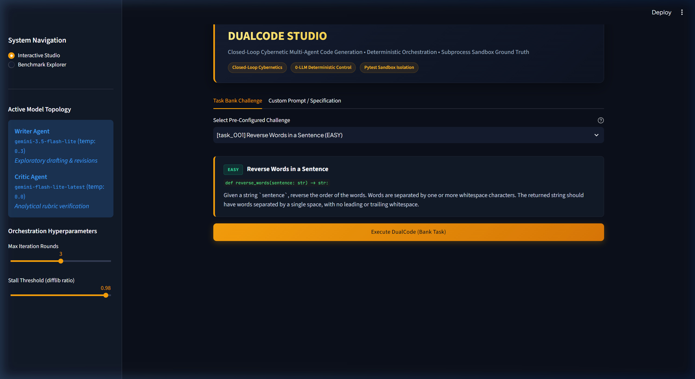
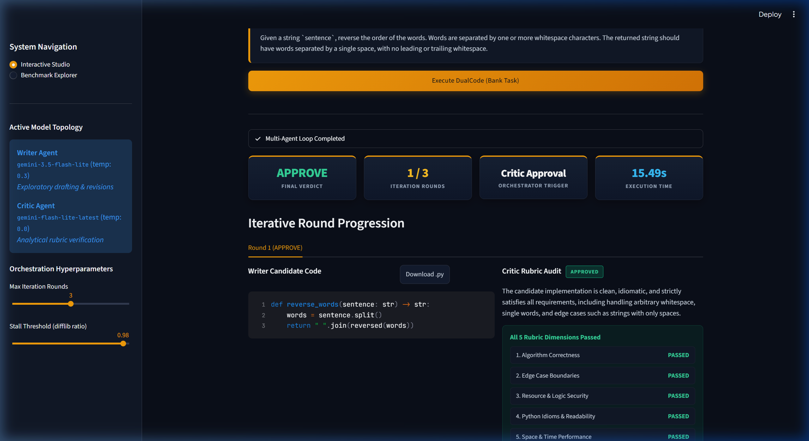

# ⚡ DualCode — Multi-Agent Code Writer & Senior Reviewer

A self-correcting multi-agent system where a **Writer agent** writes Python functions, a **Critic agent** reviews code like a senior engineer, and a deterministic **Orchestrator** (zero LLM calls) manages iterative refinement up to strict mathematical stopping conditions.

Engineered as a **closed-loop cybernetic system**: rather than an open-loop pipeline that fires a single prompt and blindly trusts the output, DualCode continuously samples candidate state (the code), measures error against 5 engineering dimensions (the Critic sensor), and applies deterministic negative feedback (the Orchestrator controller) to guide the code toward proven convergence before sandboxed execution.

Built with a relentless emphasis on **measuring and proving** that multi-agent collaboration actually improves code reliability over a single-pass baseline—not just creating an interactive demo that looks impressive.

Given a programming specification, the system drafts an initial solution, executes an asymmetric code review across 5 rigorous engineering dimensions, applies targeted revisions, and runs the final code against hidden ground-truth unit tests in an isolated execution sandbox.

<p align="center">
  
</p>

---

## Why this project exists: Open-Loop vs. Closed-Loop Cybernetic Design

Most AI workflows are **open-loop**: you pass an input to an LLM, receive text, and hope it works. If edge cases or logic bugs slip through, the pipeline has zero mechanism to detect or correct them.

Most "I built an agent" projects attempt to fix this with toy loops where two models chat back and forth in an unbounded conversational cycle. In practice, that creates three critical production problems:

1. **Unbounded Loops & Runaway Costs**: If an LLM decides when to stop, it can hallucinate agreement or loop endlessly. In this project, the **Orchestrator makes zero LLM calls**—it acts as a deterministic cybernetic controller enforcing three mathematical stopping conditions: explicit structured approval, `difflib` deadlock detection (>98% code similarity), or a strict round ceiling.
2. **Self-Critique Confirmation Bias**: When a model reviews its own output, it consistently misses its own blind spots. We solve this through **asymmetric cross-model assignment**: the Writer runs on `gemini-3.5-flash-lite` (temperature = 0.3 for creative generation), while the Critic runs on `gemini-flash-lite-latest` (temperature = 0.0 for cold, deterministic auditing).
3. **Subjective "Feel Good" Evaluation**: Asking another LLM whether the code "looks good" produces high rates of rubber-stamping. We implement an **objective ground-truth sandbox** that executes hidden `pytest` suites inside an isolated OS subprocess, tracking both **Rubber-stamping** (False Approvals) and **Hyper-criticism** (False Rejections).

---

## 📊 Results

Empirical benchmark across **4 independent evaluation passes (60 total task evaluations)** on 15 multi-tier algorithmic tasks, comparing the single-pass Baseline against the multi-agent DualCode loop:

| Metric | Run 1 | Run 2 | Run 3 | Run 4 | 4-Run Average / Spread |
| :--- | :---: | :---: | :---: | :---: | :--- |
| **Tasks Evaluated** | 15 | 15 | 15 | 15 | **60 total evaluations** |
| **Final Pass Rate** | **100.0%** | **100.0%** | **100.0%** | **100.0%** | **100.0% (Ground-truth verified)** |
| **Critic Catch Rate** | 13.3% | 20.0% | 20.0% | 33.3% | **21.7% (13.3% - 33.3% spread)** |
| **Revision Success Rate** | 100.0% | 100.0% | 100.0% | 100.0% | **100.0% (All caught bugs resolved)** |
| **False Approval Rate (Rubber-stamping)** | **0.0%** | **0.0%** | **0.0%** | **0.0%** | **0.0% (Zero rubber-stamping)** |
| **False Rejection Rate (Hyper-criticism)**| **0.0%** | **0.0%** | **0.0%** | **6.7%** | **1.7% (Twin Canary for over-critique)** |
| **Avg Rounds to Approve** | 1.07 | 1.27 | 1.27 | 1.36 | **1.24 rounds** |
| **Avg Latency (Baseline vs. Loop)** | 5.6s / 5.4s | 3.9s / 8.2s | 5.0s / 5.2s | 2.7s / 9.0s | **3.8s vs 6.9s (+3.1s safety overhead)** |

### Real-World Diagnostic Findings

- **Catching Non-Trivial Regressions (`task_012` - SemVer Parser)**: In multiple runs, the Writer's round 1 implementation used a loose regex that failed on edge cases like trailing hyphens and leading numeric zeros in prerelease tags (`1.2.3-01`). The Critic flagged the exact line number and regex flaw under the `edge_case` dimension. The Writer revised the regex in round 2, turning an initial failure into a ground-truth pass.
- **Twin Canary Signal (`task_015` - Run 4)**: On Run 4, `task_015` triggered a **False Rejection (Hyper-criticism)**: the Writer produced correct code on round 1, but the Critic demanded additional stylistic defensive checks. The Writer returned near-identical code, and the Orchestrator's `difflib` similarity detector triggered a **stall stop** (>98% similarity). The code still passed all hidden unit tests. Leaving this metric visible rather than smoothing it over proves the benchmark is authentic.

*All raw execution runs and scorecards are preserved in `eval_results/`.*

---

## 🏗️ Architecture

```
                          [ Task Specification ]
                                     │
                                     ▼
┌────────────────────────────────────────────────────────────────────────┐
│ 1. WRITER AGENT (agents/writer.py)                                     │
│ • Round 1: Spec + Signature -> Clean Python function                   │
│ • Round 2+: Previous code + Critic's itemized checklist -> Targeted fix│
│ • Model: gemini-3.5-flash-lite (temp = 0.3) with automated failover    │
└────────────────────────────────────────────────────────────────────────┘
                                     │
                                     ▼
┌────────────────────────────────────────────────────────────────────────┐
│ 2. CRITIC AGENT (agents/critic.py)                                     │
│ • Evaluates across 5 dimensions: Correctness, Edge Cases, Security,    │
│   Readability, and Performance                                         │
│ • Structured Output: APPROVE or REVISE + itemized issues               │
│ • Model: gemini-flash-lite-latest (temp = 0.0, cross-model)            │
└────────────────────────────────────────────────────────────────────────┘
                                     │
                                     ▼
┌────────────────────────────────────────────────────────────────────────┐
│ 3. ORCHESTRATOR (orchestrator.py) — Pure Deterministic Python          │
│ • Zero LLM calls; halts on:                                            │
│   a. Critic verdict == "APPROVE"                                       │
│   b. Stalled progress (>98% code similarity via difflib)               │
│   c. Max rounds ceiling reached (default: 3)                           │
└────────────────────────────────────────────────────────────────────────┘
                        │                         │
                 (Loop back to Writer)     (Final code produced)
                                                  │
                                                  ▼
┌───────────────────────────────────────┐ ┌──────────────────────────────┐
│ 4. TEST RUNNER (sandbox/test_runner)  │ │ 5. EVAL HARNESS & CLI        │
│ • Ground truth: Runs hidden tests in  │ │ • Baseline vs. DualCode      │
│   a sandboxed subprocess with timeout │ │ • Scorecards & Rich tables   │
│ • Catches rubber-stamping & deadlocks │ │ • cli.py run / eval / list   │
└───────────────────────────────────────┘ └──────────────────────────────┘
```

---

## 📁 Project Structure

```
.
├── assets/                                   # UI and architecture snapshots
│   ├── dualcode_studio_interface.png         # Main studio interface screenshot
│   └── dualcode_debate_and_consensus.png     # Multi-agent debate and rubric audit screenshot
│
├── agents/
│   ├── writer.py                             # Writer agent: code generation, AST parser, failover
│   └── critic.py                             # Critic agent: 5-dimension rubric, Pydantic structured output
│
├── tasks/
│   ├── schemas.py                            # Pydantic schemas: CodingTask, CriticVerdict, EvalScorecard
│   ├── task_bank.json                        # 15 tasks across Tier 1 (Easy), Tier 2 (Med), Tier 3 (Hard)
│   └── loader.py                             # Helper functions to load and filter task specifications
│
├── sandbox/
│   ├── test_runner.py                        # Isolated subprocess pytest runner (timeouts, secret scrubbing)
│   └── dynamic_test_oracle.py                # Autonomous QA test synthesis for custom prompt ground truth
│
├── eval/
│   └── eval_harness.py                       # Benchmarking engine: Baseline vs Loop, Twin Canaries, Catch Rate
│
├── tests/                                    # Architectural acceptance test suite (8/12 passing offline, 12/12 with live API key)
│   ├── test_slice1.py                        # Task bank validation & schema tests
│   ├── test_slice2.py                        # Writer prompt construction & code generation
│   ├── test_slice3.py                        # Critic structured output & rubric enforcement
│   ├── test_slice4.py                        # Orchestrator stopping conditions (zero LLM calls)
│   ├── test_slice5.py                        # Subprocess sandbox isolation & timeout safety
│   └── test_slice6_7.py                      # Eval harness integration & scorecard serialization
│
├── app.py                                    # Interactive Streamlit Web Studio (live debate, diffs, scorecards)
├── cli.py                                    # Interactive terminal CLI with Rich styling
├── orchestrator.py                           # Deterministic loop controller
├── config.py                                 # Environment loading & model failover configuration
├── requirements.txt                          # Python dependencies
├── .env.example                              # Template environment configuration
└── README.md
```

---

## 🚀 Setup & Installation

### Prerequisites
* Python 3.10+
* A Google Gemini API Key ([Get one here](https://aistudio.google.com/apikey))

### Install & Configure
```bash
# 1. Clone or navigate to the repository
cd "multi agent"

# 2. (Optional) Create and activate virtual environment
python -m venv venv
.\venv\Scripts\Activate.ps1    # On Windows
source venv/bin/activate       # On macOS/Linux

# 3. Install dependencies
pip install -r requirements.txt

# 4. Configure your API key in .env
cp .env.example .env
# Edit .env and paste your GEMINI_API_KEY
```

> **Note on API Keys**: If your environment already contains `GEMINI_API_KEY` in `.env` or system environment variables, it is loaded automatically. Furthermore, 8 of the 12 unit tests run 100% offline with zero API calls (testing task schemas, deterministic orchestrator stop conditions, and sandboxed execution); the remaining 4 integration tests run with a live Gemini API key.

---

## 💻 Usage

### 1. Launch the Interactive Web Studio (Streamlit)
Launch the visual multi-agent studio with side-by-side debate panels, interactive code diffs, and benchmark explorer:
```bash
streamlit run app.py
```

<p align="center">
  
</p>

### 2. View Available Tasks (CLI)
```bash
python cli.py list
```

### 3. Run a Single Task or Custom Prompt Live (CLI)
Watch the Writer and Critic collaborate in real time with syntax-highlighted terminal panels:
```bash
# Run a pre-defined challenge from the task bank:
python cli.py run --task task_012

# Or run any custom prompt / out-of-scope question directly:
python cli.py run --prompt "Write a Python function to validate and normalize IPv6 addresses without using the ipaddress library."
```

### 4. Run the Evaluation Benchmark
Run the comparative evaluation harness (Baseline vs. DualCode):
```bash
# Quick smoke test on 3 tasks
python cli.py eval --count 3

# Full benchmark across all 15 tasks
python cli.py eval
```

### 5. Run the Slice Acceptance Tests
Verify architectural components (8/12 run offline with zero API calls, 12/12 with a live Gemini key):
```bash
python -m pytest tests/ -v
```

---

## 🔑 Key Design Decisions

- **Deterministic Orchestration (Zero LLM Calls)**: The Orchestrator does not use an AI prompt to decide whether to stop. It uses strict programmatic rules: `verdict == "APPROVE"`, round limit, or `difflib.SequenceMatcher(ratio > 0.98)` stall detection.
- **Asymmetric Cross-Model Pairing**: Using different model families for Writer (`gemini-3.5-flash-lite`) and Critic (`gemini-flash-lite-latest`) prevents self-review blind spots.
- **Temperature Separation**: The Writer operates at `temperature=0.3` to explore algorithmic approaches, while the Critic is strictly pinned to `temperature=0.0` for deterministic, audit-grade reviewing.
- **Pydantic Structured Output**: The Critic is constrained to a typed schema (`CriticVerdict`) with classified issue categories (`correctness`, `edge_case`, `security`, `readability`, `performance`), preventing ambiguous conversational feedback.
- **Subprocess Isolation with Secret Scrubbing**: Code execution never happens in the main process memory. A dedicated temporary directory and subprocess run `pytest` with a 5-second timeout, stripping environment variables and API keys from any error traces.
- **Twin Canary Metrics**: Rather than only measuring pass rate, the evaluation harness tracks the two natural failure modes of AI review:
  - *Rubber-stamping*: Approving broken code (False Approval Rate).
  - *Hyper-criticism*: Rejecting working code until timeout (False Rejection Rate).

---

## ⚠️ System Boundaries & Operational Limits

- **Hyper-Criticism Deadlocks**: When a Critic insists on an alternative stylistic architecture that the Writer does not implement, the loop may stall. The `difflib` detector safely aborts the loop, but this caps iteration efficiency.
- **Latency Overhead**: Multi-turn agent collaboration requires additional LLM calls (+3.1s average overhead). This is ideal for CI/CD checks, backend code generation, and security-critical tasks, but unsuitable for real-time autocomplete.
- **Token Quota Sensitivity**: Multi-agent review naturally multiplies API token consumption. The system mitigates this via compact prompts, stripped AST markdown, and automated model failover pools.


---

## 📄 License

MIT License. Free for educational and commercial use.
